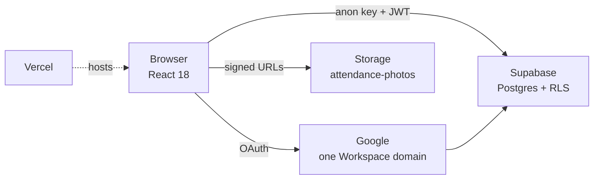
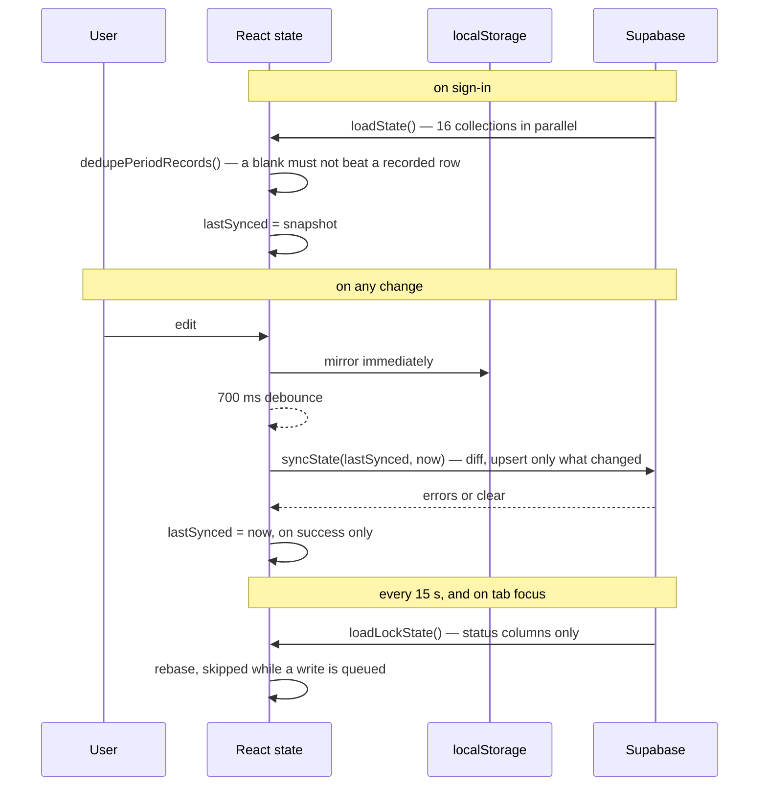
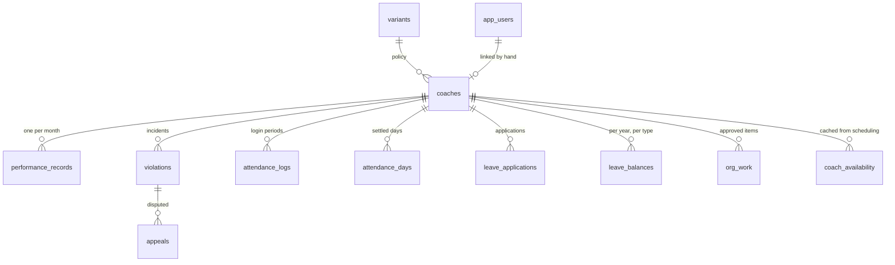
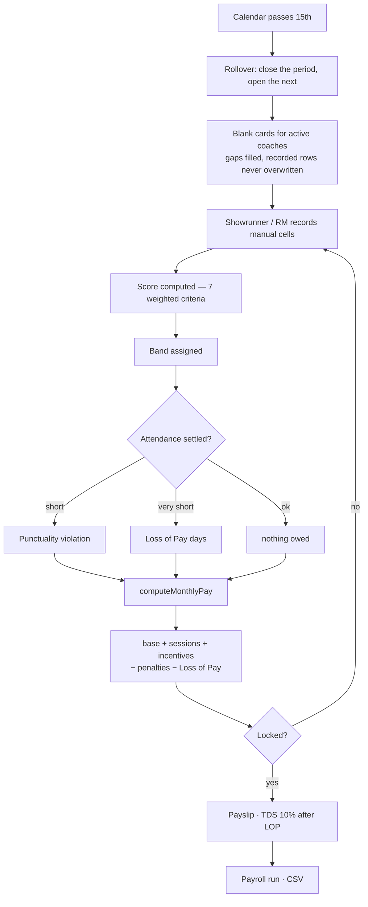
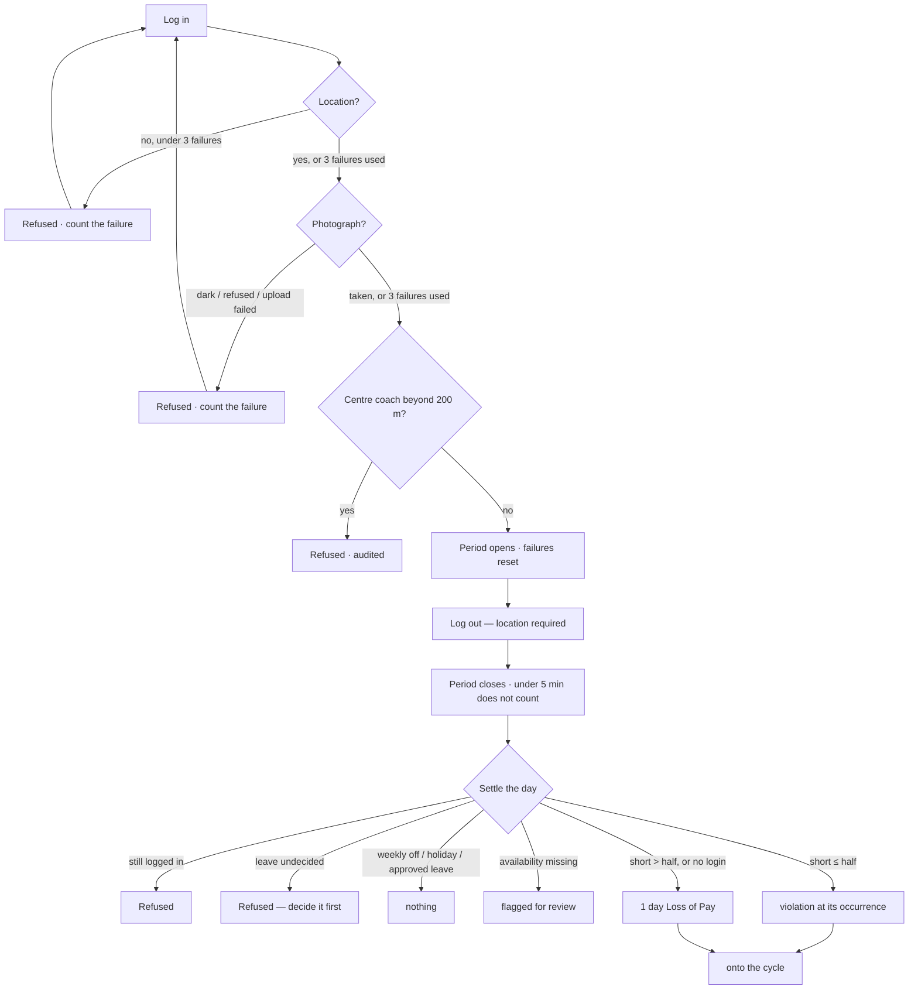
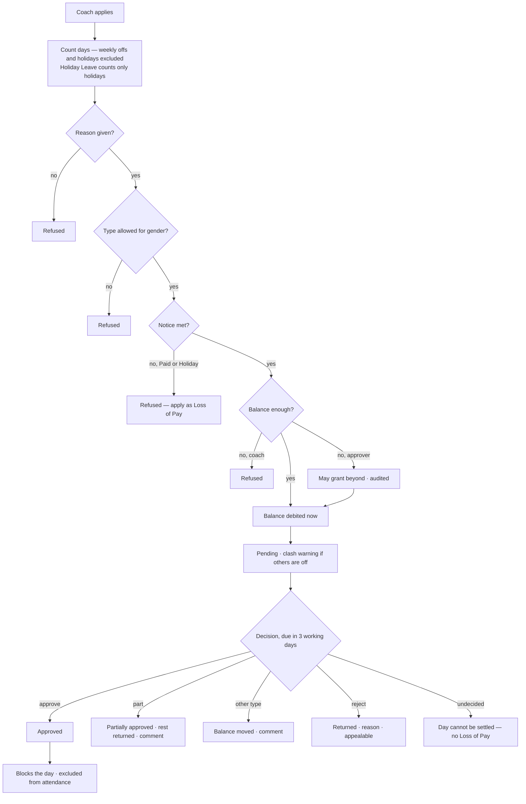
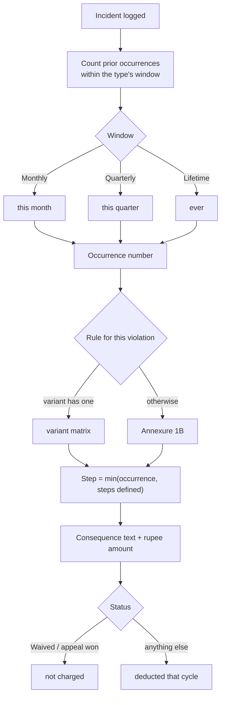
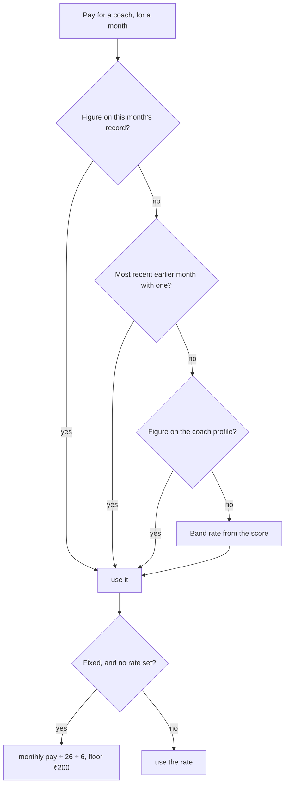

# HB+ Coach Remuneration & Performance — Technical Reference

**Companion to [PRD.md](PRD.md)**, which states the rules. This says how they
are built, where each one lives, and how data moves.

Diagrams are Mermaid — GitHub, GitLab and most wikis render them as pictures.

---

## Contents

1. [Stack and shape](#1-stack-and-shape)
2. [Modules](#2-modules)
3. [State and persistence](#3-state-and-persistence)
4. [Data model](#4-data-model)
5. [Flow — the monthly cycle](#5-flow--the-monthly-cycle)
6. [Flow — an attendance day](#6-flow--an-attendance-day)
7. [Flow — leave](#7-flow--leave)
8. [Flow — a penalty](#8-flow--a-penalty)
9. [Flow — how pay is resolved](#9-flow--how-pay-is-resolved)
10. [Migrations](#10-migrations)
11. [Where each rule lives](#11-where-each-rule-lives)
12. [Known technical debt](#12-known-technical-debt)

---

## 1. Stack and shape

React 18 · Vite 5 · Supabase (Postgres, RLS, Google OAuth) · Vercel.
No state library, no router, no component library, no test framework.



The browser holds the whole state in memory, mirrors it to `localStorage`, and
writes changes through to Postgres on a debounce. There is no server of our
own: Row Level Security is the only thing between a signed-in account and the
data.

---

## 2. Modules

```
src/
  App.jsx            12,867   every screen, every handler, all component state
  data.js             2,161   rate cards, weights, penalty matrices, seed data
  calculations.js       742   scoring, pay, penalties          31 exports
  supabaseClient.js     618   mappers, load, write-through, auth 22 exports
  leave.js              376   attendance and leave rules        28 exports
  zip.js                112   store-only ZIP writer, no dependency
  AuthGate.jsx          211   sign-in, domain check, role gate
  ErrorBoundary.jsx      76   failure screen with stack
  main.jsx               18
```

**The seam that matters:** everything except `App.jsx` is logic with no UI.
A redesign replaces `App.jsx` and keeps the rest — formulas, rules, database
access and seed data all carry over unchanged.

---

## 3. State and persistence



**Write-through, not request-response.** Nothing has a Save except where a
decision is involved. The diff is per collection, keyed per mapper.

**Two traps, both already hit:**

- A Supabase upsert is **all-or-nothing**. One column in the payload that does
  not exist in the table fails the whole statement. Three missing columns on
  `coaches` silently failed *every* coach write for weeks.
- `historicMonths` and `currentMonth` are two views of **one table**.
  Deletions are judged across every collection writing to that table, or a row
  that merely moved between them gets deleted by the one that lost it.

---

## 4. Data model



| Table | Key | Holds |
|---|---|---|
| `coaches` | `id` text | profile, bank, certifications, education, pay overrides, stage, centre |
| `performance_records` | `coach_id + period_month` | the score card, LOP days, pay overrides per month |
| `violations` | `id` | incidents, occurrence, consequence, amount, status |
| `attendance_logs` | `id` uuid | one row per login period, both locations, photo path |
| `attendance_days` | `coach_id + working_day` | the settled outcome |
| `coach_availability` | `coach_id + working_day` | **never written** — the API does not exist yet |
| `leave_applications` | `id` uuid | application, decision, approved span, notes |
| `leave_balances` | `coach_id + leave_year + type_id` | opening, accrued, used, adjusted |
| `holidays` | `id` | per leave year, optionally per centre |
| `leave_minimums` | `discipline` | **never read** |
| `variants` | `id` | weights, rate cards, milestones |
| `payroll_cycles` | `period_month` | which is open, and its lock |
| `app_users` | `id` uuid | role, coach link, RM scope |
| `audit_log` | `id` | insert-only |
| `penalty_matrix` | — | **never read** — penalties come from `data.js` |

**Sixteen synced collections**, in this order — order matters, because
`coaches` is written before the attendance tables:

```
variants · certifications · educationFormats · educationLevels · coaches
historicMonths · currentMonth · attendanceLogs · attendanceDays
leaveBalances · leaveApplications · holidays · orgWork · violations
appeals · auditLog
```

---

## 5. Flow — the monthly cycle



**Nothing is automatic except the rollover.** Scores are keyed in, days are
settled by hand, and locking is deliberate. An unsettled day never reaches
payroll.

---

## 6. Flow — an attendance day



Working day **4 AM → 2 AM**; `workingDayOf()` assigns the day, so a session
past midnight counts once against the day it began.

---

## 7. Flow — leave



---

## 8. Flow — a penalty



Past the last step defined, **the last step stands** — several violations end
at termination with no fourth step.

---

## 9. Flow — how pay is resolved



**Backwards only.** Setting August cannot change May, and each field carries
independently — a month may take its base from August and its rate from May.

---

## 10. Migrations

`supabase/` is **gitignored**, so none of this ships with the repository. It
must be handed over separately.

Run in this order:

```
schema.sql                       tables, RLS helper, domain policy
roles.sql · role-management.sql · google-auth.sql · fix-access.sql
role-showrunner.sql · role-access-widen.sql
variant-v6.sql
coach-bank-details.sql · coach-education.sql · education-levels.sql
coach-columns-repair.sql         ← pan_number, education, org_work_types
coach-per-session-override.sql
period-pay-override.sql
missed-sessions.sql
attendance-leave.sql             ← 7 tables + coach and record columns
attendance-photos.sql            ← Storage bucket and policies
attendance-rls.sql               ← policies for the 7 new tables
assign-reporting-managers.sql    ← data fix
coach-roster-import.sql          ← data
leave-test-data.sql              ← test only, every row tagged [TEST]
```

**A migration adding a column the app already sends must run before that code
deploys**, or every write to that table is rejected.

---

## 11. Where each rule lives

| Rule | File |
|---|---|
| Score, weights, bands | `calculations.js` — `computeHBPlusScore` |
| Pay, incentives, deductions | `calculations.js` — `computeMonthlyPay` |
| Fixed per-session rate | `calculations.js` — `fixedPerSessionRate` (÷6) |
| Penalty per-session rate | `calculations.js` — `fixedPenaltyPerSessionRate` (÷5) |
| Missed-session tiers | `calculations.js` — `MISSED_SESSION_TIERS` |
| Occurrence and consequence | `calculations.js` — `getPenaltyConsequence` |
| Whether a penalty is charged | `calculations.js` — `isPenaltyChargeable` |
| Working day, logged hours | `leave.js` — `workingDayOf`, `loggedHoursForDay` |
| Shortfall outcome | `leave.js` — `assessAttendanceDay` |
| Leave types and policy | `leave.js` — `LEAVE_TYPES` |
| Accrual, carry-forward | `leave.js` — `accruedDays`, `yearEndCarry` |
| Application checks | `leave.js` — `checkLeaveApplication` |
| Loss of Pay | `leave.js` — `lopPerDay`, `lopDeduction` |
| Rate cards, matrices, seed | `data.js` |
| Pay precedence, carry-forward | `App.jsx` — `resolvePay`, `carryPay` |
| Diff and write-through | `supabaseClient.js` — `syncState` |

---

## 12. Known technical debt

**`App.jsx` is 12,867 lines.** Every screen, every handler and all component
state in one file. Three production outages have come from it, all the same
shape: a `const` declared above the value it derives from, which a render
reaches immediately — `Cannot access … before initialization`, blanking the
screen. Splitting it per view is the prerequisite for any larger change.

**No tests.** Rules were verified by running them through Node against real
data during development; none of that is captured. A rebuild has nothing to
check itself against except [PRD §13](PRD.md#13-rules-that-are-not-written-anywhere-else).

**Permissions are browser-side.** Row Level Security is domain-wide: any
signed-in account on the company domain can read and write every table through
the API. Role gating decides what is *shown*, not what is *permitted*.

**No scheduler.** Auto-logout, year-end carry-forward, photo retention and
daily settlement all need one and have none. Each is written and tested, and
simply never runs.

**Dead data.** `penalty_matrix` and `leave_minimums` are tables nothing reads;
`coach_availability` is a table nothing writes; `v_current_scorecard` is an
unrestricted view nothing uses.
